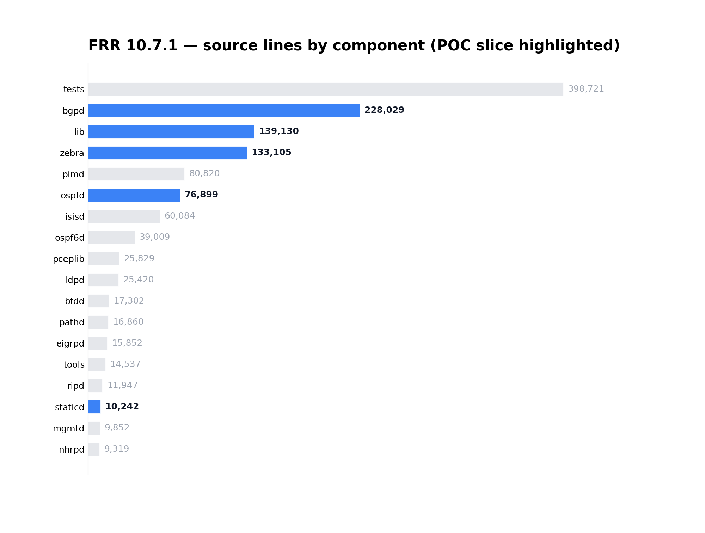

# P0 — FRR 10.7.1 Repository Census

Pinned source: `frr-10.7.1.orig.tar.xz (Debian pool, = upstream tag frr-10.7.1)`  
sha256: `b8fd6590f0f53ccd661e8c3e3a0d997f9014b62c8ed03a42e51e93291373ae52`

## Headline numbers

- **829** `.c` translation units
- **1,371,970** lines across code-bearing files (c/h/y/l/py)
- **58** YANG models, **28,021** lines (the compile-time contract plane)
- **28** files reference `nb_cb_*` northbound callbacks (runtime handler tables)
- **21** unique `zclient_send_*` message types on the ZAPI plane

## POC slice — framework touchpoints

| component | DEFUN (CLI cmds) | zclient handler assignments (runtime table) |
|---|---|---|
| `lib` | 115 | 26 |
| `zebra` | 109 | 2 |
| `bgpd` | 603 | 0 |
| `staticd` | 3 | 0 |
| `ospfd` | 197 | 0 |

`zclient handler assignments` are the `zclient->*_cb = fn` sites — the literal runtime handler tables our `zapi_reg` extractor will match. `DEFUN` blocks are the CLI surface the northbound retrofits expose through YANG.

## Top components by LOC

| component | LOC | .c files |
|---|---|---|
| `tests` | 398,721 | 66 |
| `bgpd` | 228,029 | 86 |
| `lib` | 139,130 | 144 |
| `zebra` | 133,105 | 91 |
| `pimd` | 80,820 | 65 |
| `ospfd` | 76,899 | 41 |
| `isisd` | 60,084 | 42 |
| `ospf6d` | 39,009 | 26 |
| `pceplib` | 25,829 | 49 |
| `ldpd` | 25,420 | 30 |
| `bfdd` | 17,302 | 12 |
| `pathd` | 16,860 | 17 |

## Top ZAPI message producers (`zclient_send_*`, all dirs)

| message | call sites |
|---|---|
| `zclient_send_status` | 98 |
| `zclient_send_message` | 61 |
| `zclient_send_localsid` | 10 |
| `zclient_send_reg_requests` | 7 |
| `zclient_send_interface_radv_req` | 7 |
| `zclient_send_rnh` | 6 |
| `zclient_send_dereg_requests` | 5 |
| `zclient_send_hello` | 5 |
| `zclient_send_vrf_label` | 4 |
| `zclient_send_router_id_update` | 4 |
| `zclient_send_opaque` | 4 |
| `zclient_send_neigh_discovery_req` | 4 |

## File-type census (top 15)

| ext | files |
|---|---|
| `.conf` | 2717 |
| `.ref` | 1317 |
| `.py` | 1168 |
| `.json` | 1116 |
| `.c` | 829 |
| `.po` | 797 |
| `.h` | 667 |
| `.plo` | 232 |
| `.rst` | 184 |
| `(none)` | 179 |
| `.txt` | 93 |
| `.cfg` | 69 |
| `.sh` | 66 |
| `.cocci` | 62 |
| `.yang` | 58 |
