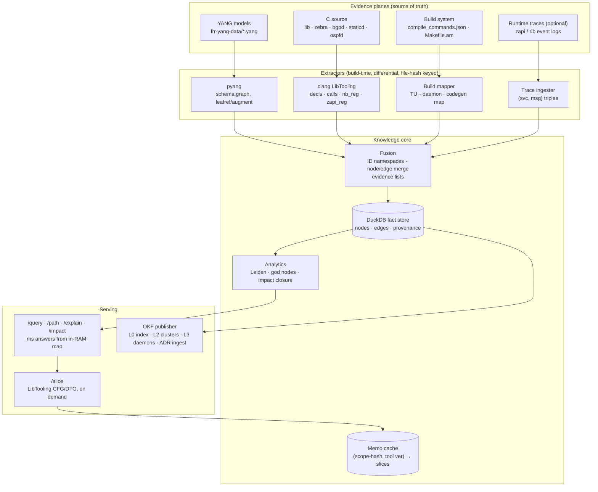

# POC Design — Code Knowledge Base over FRRouting

**Status:** POC COMPLETE — all six phases closed with passing exit gates (2026-11-12). **P6 COMPLETE** — eval shipped: **103-question golden set** (every expected key independently verified against pinned FRR source or docs; 15 unverified candidates dropped), run through the live P5 service: **P/R = 103/103 exact answers, routing accuracy 1.000, evidence-anchor rate 1.00, repeat-Q cache hits 30/30**; eval found and fixed 5 real defects (zapi-impact backend mode, linker top-level-decl ordering, yang-module mention swallowing leaf ids, entity-less docs ADR fallback, +1 router rule → 65 rules); KPI book measured: cold re-index P1→P4 **520.7s** (extraction = 97%), serve-time map load 0.55–0.67s, KB **43.3 MB ≈ 73 KB/KLOC**, structural Qs p50 0.22ms, impact cold 533ms → memoized 0.1ms; SONiC swss port rehearsed (census 598 C++ files/350,870 LOC; `addConsumer` wiring pattern located; extractor-tweak spec proven — execution needs the swss build env) (`p6/P6-REPORT.md`). Earlier: P5 COMPLETE (2026-11-12) — router v0 + instruments live: rule-based router (65 rules, 6 intents, no LLM, fired-rules transparency for the S1 drop-in) over an in-RAM KB map (30,229 n / 54,246 e + 203 clusters + 14 OKF pages, fingerprint-keyed caches); `/query` answers structural Qs in ms with per-hop evidence (path 0.32ms, callers 0.1ms, impact 553ms cold → 0.1ms memoized), `/slice` scoped CFG/DFG/liveness memoized by (scope-hash, tool ver) (`zread_route_add`: 51 blocks / 72 edges / 94 def-use chains, params from `ZAPI_HANDLER_ARGS` expansion, 495.8ms cold); repeat Q = cache hit (0.05–0.06ms); tests 69/69 incl. HTTP e2e (`p5/P5-REPORT.md`). Earlier: P4 COMPLETE (2026-11-12) — OKF bundle published: `okf-bundle/` = L0 index + 5 L2 cluster pages + 5 L3 daemon pages + 3 authored ADRs (FRR-doc-quote anchored), **454 anchored claims / 0 stripped** — rules-first verifier independently re-derives the fact index, strips unanchored claims, stamps `verified: full` on all 14 claim pages; deterministic rebuild is byte-identical; ADR ingest started empty per design, first AUTHORED facts ingested from doc/user; tests 9/9 (`p4/P4-REPORT.md`). Open gate item: FRR-knowledgeable human review of the bundle. Earlier: P3 COMPLETE (2026-11-12) — hierarchical Leiden + graph-RAG packs shipped: backbone 557n/782e → **5 domains (L1) / 5 areas (L2) / 193 code modules (L3)**, stable content-hash IDs (seed 42), no-LLM functionality/responsibilities profiles, 5 domain context packs (`p3/packs/`), recall **12/12 = 1.00** vs FRR docs (bar 0.8) PASS, stability tests 9/9 (`p3/P3-REPORT.md`). God-node ranking **skipped by user instruction**. Earlier: P2 COMPLETE — fusion & graph shipped: nb↔yang join **426/426 (100%)** via libyang lysc paths (was 28% at P1; choice/case-variant enumeration + libyang first-data-node resolution semantics), zebra server dispatch extracted (`zserv_handlers[]` 94 msgs) + wrapper-mediated sends (39 sites), 111 cross-service ZAPI flows, `graph.json` 30,229 nodes / 54,246 fused edges, query CLI (`kb.py` explain/path/impact), fusion tests 22/22 — both exit gates PASS (`p2/P2-REPORT.md`). Earlier: P1 COMPLETE — extractors v1 (libclang two-pass, pyang, build mapper), 20/20 spot-check (`p1/P1-REPORT.md`). Earlier: P0 COMPLETE — FRR `frr-10.7.1` built, schema v0.1.0 frozen (`p0/`). Next: product decision — apply the port spec to the 200-service framework layer (SONiC mapping in `p6/P6-REPORT.md` §5; P6 golden-set methodology as the acceptance harness).
**Goal:** prove the evidence-plane architecture (facts → fused graph → communities → OKF bundle) on a real repo before touching the 200-service product.
**Decisions locked:** repo = **FRRouting (FRR)** · extractor = **clang LibTooling** (Joern dropped) · diagrams = CSS renders + Mermaid sources.

---

## 1. Why FRR (and not SONiC)

| Criterion | FRR | SONiC (swss) |
|---|---|---|
| Matches "YANG → compile-time structure" | **Embedded YANG (`frr-yang-data/*.yang`) compiled via libyang + `gen_northbound_callbacks` generates callback skeletons at build time** | YANG validates CONFIG_DB; codegen is Python-side, not C++ |
| Matches "handler tables created at runtime" | **Each daemon registers its NB callback table at init (`nb_info_new` → per-XPath handlers) and assigns ZAPI handlers per message type** — two literal runtime handler tables | orchagent consumers register per Redis table at init (also a match) |
| Repo shape | **Single self-contained repo**, clone → build → index in a day | Multi-repo context (buildimage, SAI headers, containers) |
| Ground truth | **First-class developer docs** (northbound architecture guide) → free answer key for recall eval | Architecture spread across wikis/repos |
| Language | C (LibTooling handles C and C++ identically) | C++ |

FRR gives us **both** wiring planes of the user's framework in one repo: the **Northbound plane** (YANG XPath → callbacks, registered at daemon init) and the **ZAPI plane** (message type → client handler, assigned at init). SONiC stays as the Phase-6 porting target — its Redis CONFIG_DB is the closest twin to a true data-driven config plane.

**FRR slice for the POC:** `lib/` (northbound + zclient machinery), `zebra/`, `bgpd/`, `staticd/`, `ospfd/` — five "services" with real inter-service messaging, small enough to iterate fast.

## 2. LibTooling instead of Joern — what changes

Joern persisted an intermediate representation (AST+CFG+DDG per function → the 600GB lesson). LibTooling is used in **two strictly separated modes**:

1. **Bulk fact extractor (build time):** one clang tool, multiple `ASTMatcher` actions, runs per translation unit with `compile_commands.json` flags, emits **facts** (rows), never graphs:
   - `decl`: function/class, file:line, params
   - `call`: direct call edges function → callee
   - `nb_reg`: matches on `nb_info_new`, `nb_node` callbacks (`nb_cb_create`, `nb_cb_modify`, …) → **which YANG XPath each handler serves**
   - `zapi_reg`: zclient handler function-pointer assignments + `zclient_send_*` call sites → **which ZAPI message types each daemon produces/consumes**
   - `type`: structs/enums for ZAPI payload linkage (`lib/zclient.h`)
2. **Scoped instrument (query time):** the same tool computes CFG/DFG/liveness **on demand for one function/TU**, result memoized by `(content-hash(scope), tool version)`. Never persisted globally — this is the Map + Instruments split.

Non-C files: `pyang` for YANG schema; build mapper over `compile_commands.json` + `Makefile.am` for TU→daemon membership; optional trace ingester for runtime evidence. Nothing re-parses what the build already knows.

## 3. Architecture

Rendered diagram: `diagrams/architecture.png` (repo-usable Mermaid source below).



### Canonical ID scheme

```text
code:zebra::rib_add          yang:frr-ripd:rip-router   yang:frr-zebra:route
svc:bgpd                     zapi:ZEBRA_ROUTE_ADD
nb:bgpd:frr-bgp:bgp:neighbors
adr:0001                     cluster:bgp-fabric         community:12
```

### Fact schema (DuckDB, frozen at P0)

```sql
CREATE TABLE nodes (id TEXT PRIMARY KEY, kind TEXT, label TEXT, service TEXT);
CREATE TABLE edges (src TEXT, rel TEXT, dst TEXT,
                    plane TEXT CHECK(plane IN ('code','contract','wiring','build','runtime','human')),
                    tag  TEXT CHECK(tag IN ('DECLARED','CONFIGURED','OBSERVED','AUTHORED','BUILD')),
                    src_ref TEXT,           -- file:line or trace id
                    PRIMARY KEY (src, rel, dst, plane, src_ref));
-- fused edge = GROUP BY src,rel,dst → evidence = array_agg(DISTINCT tag)
```

**Merge rules:** (1) node merge on identity — codegen/build mapping collapses `gen` artifacts into their YANG node; (2) edge merge appends evidence, never discards; (3) cross-plane joins create new edges (e.g. `svc:bgpd --publishes--> zapi:ZEBRA_ROUTE_ADD --handled_by--> svc:zebra`) — paths no single extractor can see. **Authority order for reads:** `OBSERVED > CONFIGURED > DECLARED`; discrepancies surface as findings (declared-never-observed = dead wiring, etc.).

## 4. Implementation plan — 7 phases

Rendered diagram: `diagrams/phases.png`. Effort assumes 1 engineer; exits are gates, not dates.

| Phase | Scope | Exit criteria (gate) |
|---|---|---|
| **P0** Baseline & contracts (wk 1) | Pin FRR tag; build under `bear` → `compile_commands.json`; repo census (TUs, LOC, file types); **freeze** ID scheme + fact schema DDL | Build reproducible in CI; schema v0 committed; census published |
| **P1** Extractors (wk 2–3) | clang tool v1 (decl, call, nb_reg, zapi_reg, type); pyang contract dump; build mapper | Fact DB covers `lib/ + zebra + bgpd + staticd`; 20-fact spot-check vs source passes |
| **P2** Fusion & graph (wk 4) | Merge rules + evidence lists; YANG↔callback and ZAPI↔handler joins; `graph.json`; `explain/path/impact` ops | `path svc:bgpd svc:zebra` resolves via real ZAPI edge; YANG-leaf impact lists daemons + callbacks |
| **P3** Analytics (wk 5) | Leiden multi-resolution + stable IDs (overlap map); degree/god nodes with hub exclusion; report | Community report on FRR slice; recall vs FRR docs (ground truth) ≥ agreed bar (target 0.8) |
| **P4** OKF publisher (wk 6–7) | L0 index, L2 cluster, L3 daemon templates; deterministic skeleton + LLM narrative + verifier (rules first, S1 model optional); ADR ingest | FRR-knowledgeable human reviews bundle; **every narrative claim anchored**; `verified: full/partial` populated |
| **P5** Router & instruments (wk 8–9) | `/query` API + rule-based router v0 (6 intents); `/slice` CFG/DFG instrument, memoized by (scope-hash, tool ver) | E2E demo: structural Q in ms with evidence paths; lifetime/dataflow Q via scoped slice; repeat Q = cache hit |
| **P6** Eval & port (wk 10+) | Golden set ≈100 questions vs FRR docs; precision/recall report; port pipeline to SONiC swss slice; then proprietary repo (real wiring files enter as the data plane) | Measured P/R; SONiC slice runs with extractor tweaks only |

### Phase detail notes

- **P0** — `bear -- ./bootstrap && ./configure && make -j` produces `compile_commands.json`. If autotools flags confuse clang (gcc-isms), fall back to `compiledb`; record toolchain hash — it becomes part of every cache key.
- **P1** — macros hide registrations in FRR (`DEFUN`, NB table initializers). Strategy: match the *expanded* AST where possible; where not, grep fallback with the same fact schema + `tag=DECLARED, src_ref=rg:...`. Coverage is reported per extractor so silent gaps are visible.
- **P2** — the two joins that prove the concept: `nb_reg` fact XPath ↔ `pyang` schema node (contract plane ↔ code plane), and `zapi_reg` enum ↔ `type` facts from `lib/zclient.h` (wiring ↔ code). If these two joins produce real cross-daemon paths, the thesis is validated.
- **P3** — expected shape (from FRR docs): one community per daemon + a "northbound/zclient infrastructure" community + a vty/CLI community. God nodes expected: `zclient` machinery, `nb_*` dispatch, `vty_*`. If Leiden returns one giant blob → raise resolution, exclude hubs, re-run (`cluster-only` style, no re-extraction).
- **P4** — narrative generation is LLM-from-skeleton-only; verifier strips unanchored claims. ADR ingest starts empty (FRR decision docs in `doc/` become first AUTHORED facts).
- **P5** — router intents v0: `impact`, `path`, `explain`, `callers`, `slice` (dataflow), `docs`. S1-model router (Jev/Laya/CLM) is a drop-in later behind the same interface; golden set from P6 tunes it.
- **P6** — porting to SONiC = new extractors (Redis table dumps → wiring facts, orchagent consumer registration), same schema/fusion/publisher. This is the rehearsal for the product, where the wiring plane comes from real config files.

## 5. Risks

| Risk | Mitigation |
|---|---|
| Autotools/clang flag mismatch breaks LibTooling | `bear`/`compiledb`; pin toolchain; fallback grep extractor with same schema |
| Macro-hidden handler tables missed | Match expanded AST; grep fallback; per-extractor coverage report |
| One giant Leiden community | Resolution tuning + hub exclusion + split-oversized rule |
| FRR upstream drift | Pin tag; all extraction differential by file hash |
| Narrative hallucination in OKF docs | Skeleton-only LLM input + verifier + `verified` field; unanchored claims stripped |
| Cache invalidation confusion | Every artifact keyed by (content hashes, tool/extractor version); extractor bump ⇒ versioned recompute |

## 6. Deliverables per phase

```text
P0  compile_commands.json · census.md · schema.sql (v0, frozen)
P1  clang-facts tool · facts.duckdb · coverage report
P2  graph.json · query CLI (explain/path/impact) · fusion tests
P3  communities report · god-nodes report · stability tests (IDs across rebuilds)
P4  okf-bundle/ (index.md, clusters/, daemons/, adrs/) · verifier
P5  server (query/slice endpoints) · router v0 · cache
P6  eval golden set + P/R report · sonic-swss slice port
```
