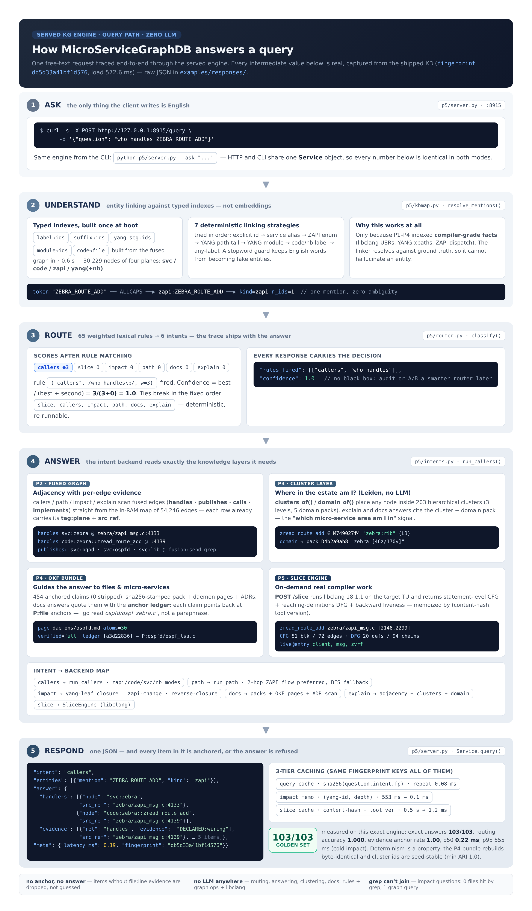

# How the KG engine answers a query — the visual flow

> Companion to the [README](../README.md) and the two-part [architecture diagram](../README.md#pipeline-p0p6).
> Every curl, JSON snippet and number on this page was **captured from the shipped KB**
> (fingerprint `db5d33a41bf1d576`); the raw responses live in
> [`examples/responses/`](../examples/responses/). No LLM is involved anywhere.



---

## The 30-second version

When you POST a question, five things happen — all deterministic, all inspectable:

| # | Stage | What runs | The running example (`who handles ZEBRA_ROUTE_ADD`) |
|---|---|---|---|
| 1 | **Ask** | `p5/server.py` — `POST /query` (or the `--ask` CLI twin) | free text in, nothing else |
| 2 | **Understand** | `p5/kbmap.py` `resolve_mentions()` — entity linking against typed indexes | `ZEBRA_ROUTE_ADD` → `zapi:ZEBRA_ROUTE_ADD` (kind `zapi`, 1 id) |
| 3 | **Route** | `p5/router.py` `classify()` — 65 weighted lexical rules → 6 intents | `callers` (score 3, confidence 1.0, rule `"who handles"`) |
| 4 | **Answer** | `p5/intents.py` backend reads the fused graph, clusters, OKF bundle — `p5/slice.py` on demand | `handlers`: `svc:zebra @ zebra/zapi_msg.c:4133`, `code:zebra::zread_route_add @ :4139` |
| 5 | **Respond** | one JSON, every item anchored; 3-tier caching | **0.19 ms**, 5 evidence items, `fingerprint db5d33a41bf1d576` |

The rest of this document walks each stage, then runs **six real queries** through the
gallery to show every tool in the engine, and closes with an honest comparison against
chunk-embedding RAG, grep-driven agent loops, LLM graph-RAG and tree-sitter KG engines.

---

## Stage 0 — where the "semantic understanding" actually comes from

The engine never embeds and never paraphrases. Its understanding of the repo was
**compiled in** during indexing (P0–P4), which is why query time is sub-millisecond:

| Layer | Built by | What it knows that plain text search does not |
|---|---|---|
| **P1 code facts** | libclang 18.1.1 over 356 real translation units (`compile_commands.json`, true flags) | functions, calls, types with compiler USRs — 30,092 nodes / 81,750 edges in ~8.5 min |
| **P1/YANG schema** | `p1/yang_facts.py` over the northbound IDL | the data model (`yang:frr-bgp-route-map:ipv4-address`) the C code implements |
| **P2 message plane** | ZAPI server dispatch table + client send-grep + libyang (`lysc`) compiled paths | cross-process edges: `svc:bgpd -publishes-> zapi:ZEBRA_ROUTE_ADD <-handles- svc:zebra` — there is **no call edge** between those functions, they live in different processes |
| **P3 clusters** | hierarchical Leiden (igraph + leidenalg), 3 levels, seed-stable | 203 clusters, 5 domain packs — "which micro-service area is this symbol in" |
| **P4 OKF bundle** | rule-rendered pages + ADRs, 454 anchored claims, 0 stripped | prose-shaped facts whose every claim carries an anchor ledger back to graph edges and `file:line`s |

Three planes are **cross-checked against each other**, and the discrepancies themselves
became findings: 4 dead registrations, 7 dropped-on-wire messages, 44 orphan handlers.
That is the difference between *indexed* semantics and *retrieved* semantics: the KB is
a fact base, not a corpus.

## Stage 1 — Ask

```bash
curl -s -X POST http://127.0.0.1:8915/query \
     -H 'Content-Type: application/json' \
     -d '{"question": "who handles ZEBRA_ROUTE_ADD"}'
```

The CLI is the same engine one-shot: `python p5/server.py --ask "..." [--json]`.
HTTP endpoints: `/query`, `/slice`, `/health`, `/admin/cache/clear`.

## Stage 2 — Understand: entity linking against typed indexes

`kbmap.resolve_mentions()` tokenizes the question and tries seven strategies in order,
stopping at the first hit per token:

1. **Explicit id** — the token is already a KB id (`svc:bgpd`, `code:zebra::zread_route_add`)
2. **Service alias** — `bgp` → `svc:bgpd`, `ospf` → `svc:ospfd`, …
3. **ZAPI enum** — `ALLCAPS` tokens get a `zapi:` prefix and are matched against message nodes
4. **YANG path tail** — full xpath tail, then last-segment fallback (≥5 chars)
5. **YANG module** — `frr-*` tokens match module nodes (deliberately *not* marked seen,
   so a later specific-leaf token still resolves — a P6 eval catch)
6. **Code / nb symbol** — by label or id tail; nested duplicates are demoted in favour of
   the top-level declaration (another P6 eval fix)
7. **Any-label fallback** — only when exactly one node matches (structs, enums, daemons)

A stopword guard keeps English words (`who`, `handles`, `message`, …) from becoming fake
entities. Because every strategy resolves against a *typed index of compiler-grade facts*,
the linker cannot invent an entity — worst case it links nothing, and entity intents
refuse with `"<intent> needs an entity"` instead of guessing.

```json
"entities": [{"mention": "ZEBRA_ROUTE_ADD", "kind": "zapi",
              "ids": ["zapi:ZEBRA_ROUTE_ADD"], "n_ids": 1}]
```

## Stage 3 — Route: 65 weighted rules, the decision ships with the answer

The router (`p5/router.py`) is a transparent weighted-keyword scorer — **9 slice,
14 callers, 10 impact, 9 path, 16 docs, 7 explain rules = 65**. It is
entity-independent by design (so it stays deterministic and testable), and every
response carries `routed.scores` + `routed.rules_fired`:

```python
("callers", r"who handles\b", 3),          # the rule that fired below
("impact",  r"what happens if\b", 3),
("path",    r"how does\b.+\b(reach|talk|send|communicate|connect)", 3),
("docs",    r"where is\b.+\b(stored|configured|kept|saved)\b", 3),
("slice",   r"where does\b.+\b(value|variable|param\w*|pointer|buffer)\b", 3),
```

```
scores:  {callers: 3, slice: 0, impact: 0, path: 0, docs: 0, explain: 0}
confidence = best / (best + second) = 3 / (3 + 0) = 1.0
tie-break order (fixed in code): slice, callers, impact, path, docs, explain
```

Measured routing accuracy over the 103-question golden set: **1.000**. If a smarter
router (e.g. an S1 model) is ever dropped in behind the same interface, the
`rules_fired` trace makes A/B comparison a diff of two JSON files — a design note from P5.

## Stage 4 — Answer: the backend reads exactly the layers it needs

| Intent | Backend | Layers touched |
|---|---|---|
| `callers` | `run_callers()` — mode depends on linked kind (`code` / `zapi` / `svc` / `nb`) | P2 graph (P3/P4 for context in `explain`) |
| `path` | `run_path()` — prefers the evidence-dense **2-hop ZAPI flow** (`publishes`+`handles`), deterministic tie-break (ROUTE-ish messages first, then lexicographic); BFS fallback (max_hops=8) | P2 graph |
| `impact` | `run_impact()` — 3 modes: `zapi-change` (senders+handlers), `yang-leaf` (NB entries → callbacks → ZAPI side-effect closure, `call_depth=10`, memoized per `(id, depth)`), `reverse-closure` (transitive `calls`, capped at 300) | P2 graph + memo |
| `docs` | `run_docs()` — cluster memberships, domain pack (sha256-stamped), up to 3 OKF pages, ADR keyword scan; entity-less questions fall back to an ADR scan (the no-anchor rule still holds) | P3 packs + P4 OKF |
| `explain` | `run_explain()` — relations grouped by type, `clusters_of()`, `domain_of()` | P2 graph + P3 |
| `slice` | `SliceEngine.slice()` — statement-level CFG, reaching-definitions DFG, backward liveness via libclang; memoized by `(content-hash(scope), tool_ver)` | on-demand compiler |

Two of these deserve a closer look.

**How clusters come into play.** `clusters_of()` maps any node to its Leiden clusters
across levels; `domain_of()` climbs the hierarchy (with a bounded walk and a
yang-module fallback) to the L1 **domain pack**. `explain` and `docs` answers cite them
directly — e.g. `code:zebra::zread_route_add` reports cluster `M749027f4 "zebra:rib" (L3)`
and domain pack `D4b2a9ab8 "zebra [46z/170y]"`. The packs themselves carry
role tags, ZAPI contracts, boundary edges to other domains and per-module *top anchors*
with file paths — that is how a docs answer steers you to `ospfd/ospf_zebra.c` rather
than to a vague summary.

**How OKF guides to files and micro-services.** The P4 bundle is rendered *from* the
graph, so every claim has an anchor ledger. The `daemons/ospfd.md` page (30 atoms,
`verified: full`) states *"svc:ospfd publishes 7 message types toward the ZAPI bus …"*
with ledger chip `[a63a4adf]` expanding to the three `publishes` edges that prove it,
and module claims like `[a3d22836]` expanding to `P:ospfd/ospf_lsa.c`,
`P:ospfd/ospf_flood.c`, `P:ospfd/ospf_dump_api.c`. A docs answer quotes the page *and*
hands you the exact files — knowledge with receipts, not a paraphrase.

## Stage 5 — Respond: anchored, cached, deterministic

The response is one JSON object: `intent`, `routed` (the router trace), `entities`,
`answer` (typed payload), `text` (compact rendering), `meta` (latency, `cache_hit`,
`fingerprint`). Two invariants:

- **No anchor, no answer.** Every item carries `src_ref` (`file:line`) and a plane tag
  (`DECLARED:code`, `DECLARED:wiring`, `fusion:send-grep`, …). The docs intent anchors to
  pack/page files with sha256 from the P4 manifest. Items that would be unanchored are
  dropped, not guessed.
- **Cache tier 1 is keyed by knowledge, not by time**: `sha256(normalized question,
  intent, max_hops, call_depth, kb fingerprint)` — any re-index changes the fingerprint
  and invalidates every cache at once. Re-asking the demo question costs **0.08 ms**
  (`"cache_hit": true`); the yang-impact memo collapses 553 ms → 0.1 ms; the slice cache
  collapses ~0.5 s of libclang work → 1.2 ms.

Determinism is measured, not claimed: the P4 bundle rebuilds byte-identical, cluster ids
are seed-stable (min ARI 1.0 across seeds), and a full P6 end-to-end re-run reproduced
30,229 nodes + 54,246 edges deep-equal (59/63 artifacts byte-identical; 4 volatile by
design, e.g. DuckDB layout).

---

## Trace gallery — six real queries, every tool showcased

Raw JSON for each is in [`examples/responses/`](../examples/responses/); snippets below
are trimmed for readability, nothing else changed.

### 1. Framework dispatch: *who handles ZEBRA_ROUTE_ADD* (`q_who_handles.json`)

The question grep answers worst: the enum string appears in a header, in every sender,
and in the dispatch table — with no way to tell which side is which. The KG answers it
as a **join on the message node**:

```bash
curl -s -X POST http://127.0.0.1:8915/query -d '{"question": "who handles ZEBRA_ROUTE_ADD"}'
```

```json
{"intent": "callers", "confidence": 1.0,
 "routed": {"rules_fired": [["callers", "who handles"]]},
 "answer": {"target": "zapi:ZEBRA_ROUTE_ADD", "mode": "zapi",
   "senders":  [{"node": "svc:lib",   "src_ref": "fusion:send-grep"},
                {"node": "svc:ospfd", "src_ref": "fusion:send-grep"},
                {"node": "svc:bgpd",  "src_ref": "fusion:send-grep"}],
   "handlers": [{"node": "svc:zebra", "src_ref": "zebra/zapi_msg.c:4133"},
                {"node": "code:zebra::zread_route_add", "src_ref": "zebra/zapi_msg.c:4139"}],
   "evidence": ["… 5 items, each with tag:plane + src_ref …"]},
 "meta": {"latency_ms": 0.19}}
```

Inside: linking strategy 3 (ALLCAPS → `zapi:`), rule `who handles\b`, `run_callers`
zapi mode scanning `publishes`/`handles` adjacency. The `fusion:send-grep` tag marks
edges recovered by P2's client-side send-wrapper analysis and cross-checked against the
server dispatch table — the framework layer, statically.

### 2. Plain call sites: *who calls zclient_route_send* (`q_who_calls.json`)

```bash
curl -s -X POST http://127.0.0.1:8915/query -d '{"question": "who calls zclient_route_send"}'
```

**0.17 ms**, 10 callers across 4 services, each with `file:line`:

```json
{"answer": {"target": "code:lib::zclient_route_send", "mode": "code", "callers": [
  {"node": "code:lib::zclient_send_localsid",    "service": "svc:lib",    "src_ref": "lib/zclient.c:603"},
  {"node": "code:ospfd::ospf_zebra_add",         "service": "svc:ospfd",  "src_ref": "ospfd/ospf_zebra.c:352"},
  {"node": "code:bgpd::bgp_zebra_announce_actual","service": "svc:bgpd",  "src_ref": "bgpd/bgp_zebra.c:1741"},
  {"node": "code:staticd::static_zebra_route_add","service": "svc:staticd","src_ref": "staticd/static_zebra.c:561"},
  "… 6 more …"], "evidence": ["… 10 items …"]}}
```

Re-ask it: **0.08 ms**, `"cache_hit": true` — tier-1 cache, keyed by the KB fingerprint.
The call edges come from libclang over real translation units, so conditional
compilation and header plumbing are already resolved — this is where a tree-sitter
syntactic index starts guessing and grep starts drowning (median 7 files of raw noise
for this question class).

### 3. Cross-process reachability: *path from svc:bgpd to svc:zebra* (`q_path.json`)

```bash
curl -s -X POST http://127.0.0.1:8915/query -d '{"question": "path from svc:bgpd to svc:zebra"}'
```

**0.30 ms** — a 2-hop ZAPI flow, per-hop evidence:

```json
{"answer": {"hops": 2, "via": "zapi:ZEBRA_ROUTE_ADD", "path": [
   {"from": "svc:bgpd", "to": "zapi:ZEBRA_ROUTE_ADD", "rel": "publishes"},
   {"from": "zapi:ZEBRA_ROUTE_ADD", "to": "svc:zebra", "rel": "handles"}]},
 "text": "path svc:bgpd -> svc:zebra  (2 hops)  via zapi:ZEBRA_ROUTE_ADD (ZAPI flow)\n  evidence items: 2 (per-hop tag:plane + src_ref)"}
```

Inside: `run_path` first tries the preferred 2-hop pattern (request, then notification
direction) with a deterministic tie-break; only if no message hub exists does it fall
back to BFS over all endpoint pairs. **111 cross-service ZAPI flows** are encoded in the
fused graph. A call-graph tool cannot express this path at all — there is no call edge
between the two daemons; the bus hop *is* the answer.

### 4. The deep one: *what is the impact of yang:frr-bgp-route-map:ipv4-address* (`q_impact.json`)

```bash
curl -s -X POST http://127.0.0.1:8915/query -d '{"question": "what is the impact of yang:frr-bgp-route-map:ipv4-address"}'
```

**552 ms cold** (depth-10 closure), **0.1 ms memoized** afterwards; confidence 0.6:

```json
{"answer": {"target": "yang:frr-bgp-route-map:ipv4-address", "mode": "yang-leaf",
   "daemons": ["svc:bgpd"], "nb_entries": 2, "callbacks": 4,
   "zapi_side_effects": {"zapi:ZEBRA_INTERFACE_ADD":      ["svc:lib", "svc:zebra"],
                         "zapi:ZEBRA_GET_LABEL_CHUNK":    ["svc:zebra"],
                         "zapi:ZEBRA_ROUTE_NOTIFY_OWNER": ["svc:bgpd", "…"]},
   "evidence": ["… 6 items …"]}}
```

Inside: `run_impact` yang-leaf mode — YANG leaf → `implements` → NB registration entries
→ `handles` → callbacks → transitive call closure → each callback's `publishes` edges →
handled-by services. Grep baseline for this question: **0 files hit** (the question
vocabulary never appears in the code); overall this leaf fans out to **82 side-effect
messages** through the closure. Embedding retrieval has no mechanism for a multi-hop
typed join; an LLM graph-RAG would need to *trust* LLM-built edges for a safety question.

### 5. Docs with receipts: *what are the responsibilities of ospfd* (`q_docs.json`)

```bash
curl -s -X POST http://127.0.0.1:8915/query -d '{"question": "what are the responsibilities of ospfd"}'
```

**1.01 ms** — cluster pack + OKF page + ADRs, all anchored:

```json
{"answer": {"clusters": 2,
   "pack": {"id": "Ded29f1c0", "label": "ospfd [15z/1y]",
            "functionality": ["ospfd is a route client: publishes 7 message types toward the ZAPI bus …"],
            "sha256": "…from the P4 manifest…"},
   "okf_pages": [{"page": "daemons/ospfd", "okf_level": "L3-daemon", "atoms": 30}],
   "adrs": [{"adr": "ADR-0001-zapi-ipc.md"}, "…"]},
 "text": "docs for svc:ospfd\n  domain pack Ded29f1c0 'ospfd [15z/1y]'\n    - ospfd is a route client: publishes 7 message types …"}
```

Inside: `run_docs` prefers the `svc` mention, loads `clusters_of()` memberships
(roles `zapi-client, zapi-publisher`), the L1 domain pack with its sha256 from the OKF
manifest, the daemon page (30 anchored atoms) and ADRs matching the entity. This is the
OKF layer doing its job: **guiding from a question to a micro-service, its contract, and
the exact files** — with hashes so you can verify the prose against the graph it was
rendered from.

### 6. Real compiler work on demand: `POST /slice` (`q_slice.json`)

```bash
curl -s -X POST http://127.0.0.1:8915/slice \
     -H 'Content-Type: application/json' \
     -d '{"file": "zebra/zapi_msg.c", "function": "zread_route_add"}'
```

**1.2 ms** on a disk-cache hit (first compute ≈ 0.5 s), tool `p5-slice/1.0.0+clang18`:

```json
{"scope": {"file": "zebra/zapi_msg.c", "function": "zread_route_add", "line_span": [2148, 2299]},
 "cfg":  {"n_blocks": 51, "n_edges": 72, "entry": 0, "exit": 1,
          "blocks": [{"id": 0, "tag": "entry",
                      "stmts": [{"kind": "DECL_STMT", "line": 2150, "spell": "struct stream * s ;"}]}]},
 "dfg":  {"defs": 20, "n_chains": 94, "undef_uses": 61,
          "chains": [{"use": "msg", "line": 2161, "stmt": "s = msg", "defs": ["d18"]}]},
 "liveness": {"params_live_at_entry": ["client", "msg", "zvrf"]}}
```

Inside: the slice engine re-parses the single TU with the *same* libclang setup the
indexer used (`MSG_CC` + `MSG_SRC`), builds a statement-level CFG (then/else/loop/switch
edges), reaching definitions with def-use chains, and backward liveness — then memoizes
by content hash + tool version. Where a "where does this value come from" question would
send an embedding search or a coding agent wandering, this is a compiler answer.

---

## Where classic engines struggle — and what we do instead

Framed by **mechanism class** (the interesting comparison), not by product bashing —
each class is good at what it was built for.

| Question class | Chunk-embedding RAG (Copilot-style retrieval) | Grep/agent loops (opencode-style CLI agents) | LLM-built graph-RAG | Tree-sitter KG (graphify / gitnexus class) | **MicroServiceGraphDB** |
|---|---|---|---|---|---|
| *Who handles ZEBRA_ROUTE_ADD* | retrieves every file containing the string; sender vs handler indistinguishable | finds the enum + dispatch table; agent burns tokens inferring roles | edges are LLM claims; dispatch tables inside macros often missed | single-file syntax view; registration via static tables + enums is invisible | **typed `publishes`/`handles` join, 0.19 ms, both sides anchored** |
| *Path svc:bgpd → svc:zebra* | no path notion over chunks | no join; walks both daemons file by file | plausible path, needs verification | **no call edge exists** (different processes) — cannot express the bus hop | **2-hop ZAPI flow with per-hop evidence, 0.30 ms** |
| *Impact of a YANG leaf* | vocabulary absent from code → irrelevant chunks | **0 files hit** (measured); nothing to iterate on | multi-hop join over LLM edges — risky for a safety question | YANG schemas invisible to a C parser | **NB → callbacks → ZAPI closure, 82 side-effect messages, memoized 0.1 ms** |
| Evidence | similar chunks, no proof | raw hits, no typing | prose over unverified edges | syntactic locations only | **every item: `tag:plane` + `src_ref`; no anchor → refused** |
| Determinism / cost | varies per query & model | varies per agent run | LLM bill per commit; re-verify per re-index | fast, deterministic | **byte-identical rebuild; 520.7 s cold re-index; 0.2 ms p50 answers; no LLM anywhere** |

**Where the tree-sitter class (graphify, gitnexus) is genuinely strong** — instant
multi-language indexing, great for "where is this symbol" — and where the ceiling sits:
tree-sitter parses *syntax*, one file at a time. It does not see the three things this
project exists for:

1. **Framework registration.** FRR's ZAPI handlers are reached through the static
   dispatch table `zserv_handlers[]` (`zebra/zapi_msg.c:4133-4230`), indexed by the
   message enum — no call edge from any sender exists; only dispatch-table recovery
   finds `zapi:ZEBRA_ROUTE_ADD → zread_route_add`.
2. **The message bus.** `bgpd` and `zebra` are separate processes; their coupling is
   publish/handle over ZAPI streams. A syntactic call graph is structurally blind to it —
   which is exactly why grep-based agents can't answer path/impact questions here.
3. **The schema plane.** The northbound contract lives in YANG files compiled by libyang;
   matching `yang:frr-bgp-route-map:ipv4-address` to NB handler tables requires the
   compiled schema paths (our P2 join: **426/426, 100%**).

And the honest mirror: **what we deliberately do not do.** Six intents, not free-form
chat; answers are factual and structural, not prose essays; the KB is a per-repo artifact
(43.3 MB ≈ 73 KB/KLOC here); cold impact closure costs ~0.5 s; and the POC proves the
method on one codebase (FRR 10.7.1, 589,874 LOC indexed) standing in for a
200-microservice estate. The point is not that RAG is bad — it is that for the
*framework layer*, retrieval is the wrong tool: the facts are derivable, so we derive
them once and answer from facts.

## Reproduce it

```bash
python p5/server.py --serve &                 # boots in ~0.6 s from data/facts/
curl -s http://127.0.0.1:8915/health | python3 -m json.tool
python p5/demo_e2e.py                          # scripted end-to-end demo transcript
python p5/tests_p5.py                          # 69 checks incl. real-socket e2e
```

Source map for this page: router rules `p5/router.py` · linking `p5/kbmap.py` ·
backends `p5/intents.py` · caching/endpoints `p5/server.py` · slice engine `p5/slice.py` ·
eval numbers `docs/reports/P6-REPORT.md` and `p6/kpis.json`.
