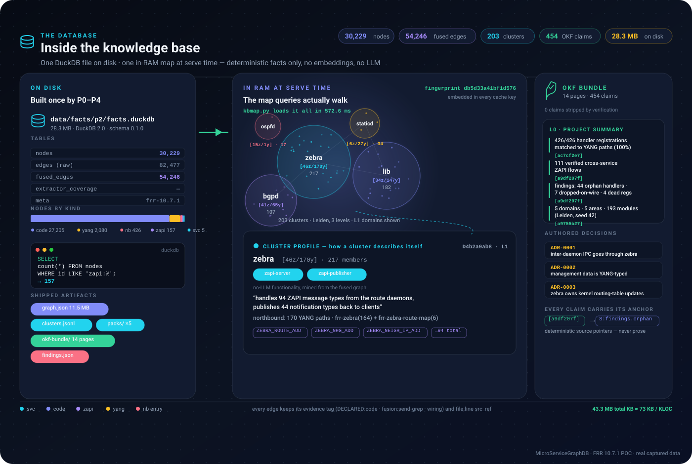

# See it work — the database, the journey of a query, and every route through the engine

> Companion to the [README](../README.md). **Every pixel of data in the diagrams is real**:
> captured from the shipped knowledge base (fingerprint `db5d33a41bf1d576`) on FRR 10.7.1.
> Raw responses backing each panel: [`examples/responses/`](../examples/responses/).
> **No LLM, no embeddings — anywhere.**

---

## 1 · What the database looks like

One DuckDB file on disk, one in-RAM map at serve time. The clusters are the map's
geography; the OKF bundle is its project-level memory; every fact keeps its anchor.



- **On disk** — `data/facts/p2/facts.duckdb` (28.3 MB): tables `nodes` (30,229) / `edges` (82,477 raw) / `fused_edges` (54,246), plus the shipped `graph.json`, cluster packs and the 14-page OKF bundle.
- **In RAM** — `kbmap.py` loads it all in 572.6 ms into one map; a content fingerprint (`db5d33a41bf1d576`) is embedded in every cache key, so any upstream change invalidates all caches automatically.
- **Clusters** — 203 Leiden clusters over 3 levels; each carries a no-LLM profile: roles, functionality, YANG modules, ZAPI messages (see the expanded zebra card).
- **OKF** — 454 anchored claims across 14 pages, 0 stripped by verification; the L0 index is the project-level summary, and every claim resolves to deterministic source pointers (`S:findings.orphan`, graph stats, `file:line`s).

---

## 2 · The journey of a query

Follow one real request — `who handles ZEBRA_ROUTE_ADD` — from curl to evidence-carrying JSON:


That is the whole machinery: **understand → route → walk → respond**, end-to-end in 0.19 ms,
deterministic on replay. The `src_ref` pins (`zebra/zapi_msg.c:4133`, `fusion:send-grep`)
are what make answers checkable — open the file, the handler registration is there.

---

## 3 · Seven routes through one engine

Different questions lean on different parts of the map. Read it like a metro map:
each row is a question type, each lit station is a subsystem it touches.


Run them yourself against the served KB:

```bash
curl -s localhost:8915/query -d '{"question": "who handles ZEBRA_ROUTE_ADD"}'   # 0.19 ms
curl -s localhost:8915/query -d '{"question": "who calls zclient_route_send"}'  # 0.17 ms
curl -s localhost:8915/query -d '{"question": "path from svc:bgpd to svc:zebra"}'
curl -s localhost:8915/query -d '{"question": "what is the impact of yang:frr-bgp-route-map:ipv4-address"}'
curl -s localhost:8915/query -d '{"question": "what are the responsibilities of ospfd?"}'
curl -s localhost:8915/query -d '{"question": "explain code:zebra::zread_route_add"}'
curl -s localhost:8915/slice -d '{"file": "zebra/zapi_msg.c", "function": "zread_route_add"}'  # CFG + DFG
```

Every lane returns the same shape: typed entities, routed intent (with `rules_fired`),
the answer, and **per-item evidence** (`rel` + tag + `src_ref` `file:line`) + fingerprint.
Full captured bodies for each: [`examples/responses/`](../examples/responses/).

---

## 4 · How it was built — build once, serve forever


The semantic understanding is **compiled in during indexing** (P0–P4) — that is why serving
needs no model at query time. Three planes are cross-checked against each other during the
build, and the discrepancies became findings: 4 dead registrations, 7 dropped-on-wire
messages, 44 orphan handlers. Evaluation numbers: [`docs/reports/P6-REPORT.md`](reports/P6-REPORT.md).

---

## 5 · Where other engines struggle on this layer

| Question class | Chunk-embedding RAG | LLM graph-RAG | Tree-sitter KG (graphify / gitnexus class) | Copilot / opencode agent loops | **This DB** |
|---|---|---|---|---|---|
| *who handles ZEBRA_ROUTE_ADD?* | handler name scattered across chunks; hope it ranks | may answer, but slow + non-deterministic | sees the C function, misses the **ZAPI dispatch registration** | greps, may find the table after several hops | **0.19 ms, exact, with the `file:line`** |
| *bgpd → zebra message flow* | cross-process edges do not exist in text | hallucination risk on synthesized edges | no process boundary in its graph | reconstructs by reading both sides, every time | **fused edge, evidence-tagged, 100% NB-matched** |
| *impact of a YANG leaf* | needs the schema↔code join it cannot see | LLM guess, unverifiable | YANG is just another file | manual exploration | **family walk: 4 callbacks · 82 ZAPI side-effects** |
| *what does this cluster do?* | chunk soup | needs an LLM pass per cluster | clusters code only, no message plane | reads files, then summarizes | **no-LLM pack + 454 anchored claims** |
| dead registrations / orphans | invisible (they look like normal code) | invisible | invisible | visible only after deep manual analysis | **surfaced by cross-plane fusion at build time** |
| latency · cost · determinism | ~100 ms–1 s, embedding cost, drift | seconds, $$, varies per run | ms, but incomplete edges | seconds–minutes of tool calls | **p50 0.22 ms, free, byte-identical replays** |

The pattern: on the **framework layer** — services registering with a framework and talking
over its bus — the load-bearing edges cross process boundaries and live in dispatch tables,
send-sites and schema paths. Grep, embeddings and tree-sitter all approximate them;
libclang + compile-time fusion + anchored claims pin them.

---

*Diagrams: `docs/img/inside-kb.svg` · `query-journey.svg` · `query-types.svg` ·
`architecture-visual.svg` (hand-built SVG, no external assets — they render on GitHub,
in dark or light mode). Numbers: `p6/kpis.json` · method: `docs/reports/P6-REPORT.md`.*
